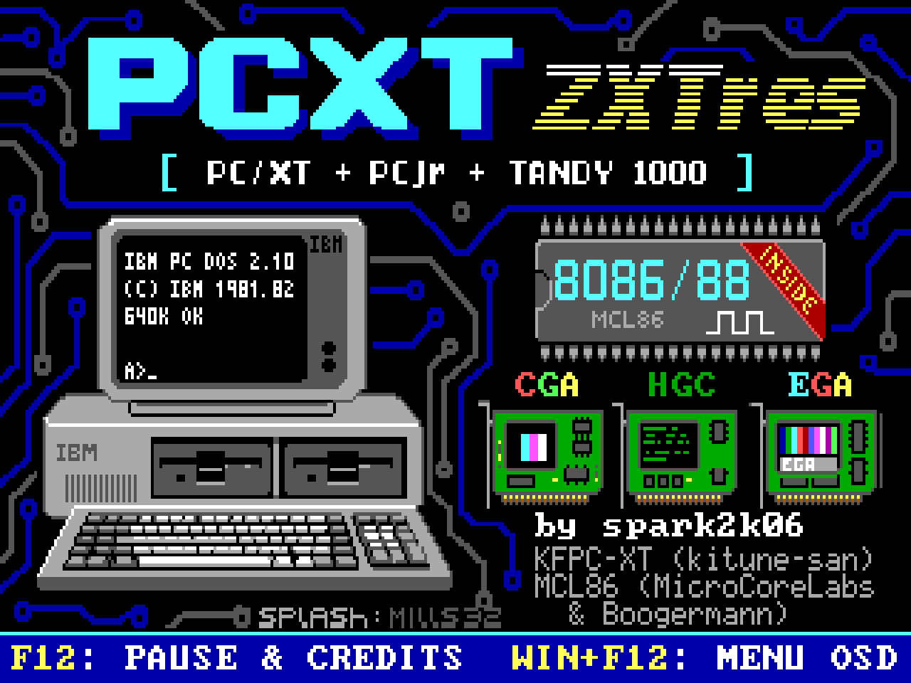

# [IBM PC/XT](https://en.wikipedia.org/wiki/IBM_Personal_Computer_XT), Tandy 1000 and IBM PCjr for the ZXTRES, ZXTRES+ and ZXTRES++

PCXT for the ZXTres boards by [@spark2k06](https://github.com/aitorgomez-net/),
ported from [PCXT MiSTer](https://github.com/aitorgomez-net/PCXT_MiSTer).



**Documentation:** [aitorgomez-net.github.io/PCXT_ZXTres](https://aitorgomez-net.github.io/PCXT_ZXTres/)
(source in [`docs/`](docs/index.html)):
[getting started](docs/guide.html) ·
[boards and builds](docs/builds.html) ·
[OSD reference](docs/osd.html) ·
[technical report](docs/report/CORE_REPORT.html)

## Description

This core recreates an IBM PC/XT-compatible machine as RTL on the Xilinx
Artix-7 of the ZXTRES boards by [Antonio Villena](https://antoniovillena.com/).
It is the machine of the PCXT MiSTer core, built around the
[MCL86 CPU](https://github.com/MicroCoreLabs/Projects/tree/master/MCL86) and the
[KFPC-XT chipset](https://github.com/kitune-san/KFPC-XT): real bus transactions,
chipset timing, memory windows, video I/O and peripherals are represented in
the FPGA. One design covers three machines: the IBM PC/XT (with CGA and
Hercules, or an IBM EGA card), the Tandy 1000 (CGA with its Tandy video modes
and sound) and the IBM PCjr (its video gate array, IR keyboard and
cartridges).

The machine RTL is shared with MiSTer: `zxtres/rtl/pcxt_zxtres_guest.sv` is
generated from `PCXT.sv`, so a fix in the machine reaches both. Only the logic
around it is specific to these boards: the
[DeMiSTify](https://github.com/robinsonb5/DeMiSTify) controller and its OSD,
the microSD card, VGA and 15 kHz video with an SRAM scan converter, and the
board's audio. The board layer comes from the
[PCAT-286 ZXTres port](https://github.com/aitorgomez-net/PCAT-286_ZXTres).

## Boards and builds

| Board | FPGA | Release folder | Build | State |
| --- | --- | --- | --- | --- |
| ZXTRES+ | XC7A100T | [`releases/A100T-board`](releases/A100T-board) | Full core: PC/XT, Tandy 1000 and PCjr, CGA/Hercules or EGA, chosen in the OSD | First board tests |
| ZXTRES++ | XC7A200T | [`releases/A200T-board`](releases/A200T-board) | The same full core | Built, not tried on a board |
| ZXTRES | XC7A35T | [`releases/A35T-board`](releases/A35T-board) | Four builds of one machine each | Built, not tried on a board |

A bitstream is made for one FPGA and does not load on another. Each build is
a `.ZX3` file, loaded from the ZX Spectrum core, and a `.BIT` file with the
same contents for the core menu of the MiST firmware on the middle board.

The XC7A35T (20,800 LUTs) does not hold the full core (about 25,000), so the
ZXTRES has four builds. Each fixes the machine and the card, and its OSD shows
only the options of what it holds:

| ZXTRES build | Machine | Video | Sound | Memory | Not included |
| --- | --- | --- | --- | --- | --- |
| `PCXT_CGAHGC` | IBM PC/XT | CGA and Hercules | OPL2, Sound Blaster Pro, SN76489 | EMS, A000 UMB | EGA, Tandy 1000, PCjr |
| `PCXT_EGA` | IBM PC/XT | EGA | OPL2, Sound Blaster Pro, SN76489 | EMS, UMB C400 | CGA, Hercules, Tandy 1000, PCjr |
| `TANDY1000` | Tandy 1000 | CGA with the Tandy modes | SN76489, OPL2 (AdLib) | EMS, A000 UMB | Hercules, EGA, Sound Blaster, PC/XT, PCjr |
| `PCJR` | IBM PCjr | CGA with the PCjr gate array | SN76489, tape sound | 128–640 KiB | OPL2, Sound Blaster, EMS, PC/XT, Tandy 1000 |

None of the ZXTRES builds has C/MS or COM2, and only the PCjr build keeps the
RTC device. FPGA resources, timing and the optimisations that make them fit
are on the [boards and builds](docs/builds.html) page.

## Key features

* IBM PC/XT, Tandy 1000 or IBM PCjr, chosen in the OSD on the ZXTRES+ and ZXTRES++
* 8088 or 8086 bus mode; 4.77, 7.16 and 9.54 MHz, and **Max** (unthrottled)
* 640 KiB of conventional memory, A0000h and C4000h UMBs, 2 MiB of Lo-tech EMS at D000h
* CGA with simulated composite colour and display tints, Hercules, IBM EGA (5151, 5153, 5154 monitors), Tandy 1000 and PCjr video
* CRTC frame stacking (**Rebuilt**) for per-scanline CRTC tricks
* VGA output: 200-line modes line doubled to 31 kHz, 350-line modes at 480p through an SRAM scan converter; 15 kHz output for televisions
* AdLib (OPL2), Sound Blaster Pro, C/MS, SN76489, PC speaker and PCjr tape sound, to the audio jack and I2S
* PS/2 keyboard, PS/2 mouse as a serial mouse on COM1, two DB9 joysticks
* Floppy A/B, two hard disks through the XT-IDE BIOS, two PCjr cartridges, all from the microSD card
* Boot splash, F12 pause and credits, a startup hold while the BIOS is missing
* Return to the Spectrum core from the OSD (**Reload ZX core**)

## Differences from the MiSTer core

| MiSTer | ZXTres |
| --- | --- |
| HPS and the MiSTer menu | DeMiSTify controller with the port's firmware and OSD |
| Scaler, HDMI, aspect ratio, scanlines | VGA at 31 kHz or 15 kHz; no HDMI or DisplayPort |
| DDR3 framebuffer for the 350-line modes | Scan converter in the board's SRAM, 480p by default |
| MGL profiles | The machine is chosen in the OSD (full core) |
| MIDI, MPU-401, MT32-pi, COM2 on the user port | The board has no user port |
| Second SD card as an IDE disk | The one microSD slot belongs to the controller |
| RTC set from the HPS | No clock source on the board |
| Analog joysticks | DB9 ports: directions and buttons |
| Configuration created by the core | `PCXT.CFG` must exist on the card |

## Quick start

1. Make a folder `PCXT` at the root of the microSD card with the BIOS files
   (`PCXT.ROM`, `EC00.ROM`, and `TANDY.ROM`, `PCJR.ROM` or `EGA.ROM` as needed)
   and a `PCXT.CFG` of 512 zero bytes ([`releases/PCXT.CFG`](releases/PCXT.CFG)
   is one). The [BIOS Builder](https://aitorgomez-net.github.io/PCXT_MiSTer/BIOS_Builder/)
   of the MiSTer project prepares the ROMs; rename them as the
   [guide](docs/guide.html#card) shows.
2. Copy the `.ZX3` file of your board from `releases/`, and a disk image (the
   FreeDOS image in `games/PCXT/hd_image.zip` is a good start).
3. In the ZX Spectrum core, press **F5** for the NMI browser and load the
   `.ZX3`.
4. Open the OSD with **Win+F12**. On the full core, choose the **Machine** and,
   for a PC/XT, the **Video card**. Mount the disk image.
5. Choose **Reset & apply**, then **Save settings** on the page **Settings**.

While the BIOS of the machine in use is missing, the splash stays on screen
and the machine is held in reset. **Reload ZX core** on the page **Settings**
goes back to the Spectrum core. The [getting-started guide](docs/guide.html)
covers video, keys, joysticks, mouse, disks and troubleshooting.

## Building

The build needs Vivado 2025.2, Python 3, and `nasm`, `gcc` and `make` for the
controller firmware (from WSL on Windows), with the submodules checked out.
Run the scripts from the repository root, from Git Bash or Linux:

```sh
git submodule update --init --recursive
zxtres/scripts/build_pcxt.sh                                       # ZXTRES+ (A100T)
zxtres/scripts/build_pcxt.sh A200T                                 # ZXTRES++ (A200T)
PCXT_PROFILE=zx3_a35t_pcxt_cgahgc zxtres/scripts/build_pcxt.sh A35T  # one ZXTRES build
```

The ZXTRES profiles are `zx3_a35t_pcxt_cgahgc`, `zx3_a35t_pcxt_ega`,
`zx3_a35t_tandy1000` and `zx3_a35t_pcjr` in [`profiles/`](profiles); the full
core uses `mister_pcxt_full`. Output, project mode and simulation are
described in [`zxtres/README.md`](zxtres/README.md#building) and on the
[boards and builds](docs/builds.html#building) page.

The MiSTer Quartus project (`PCXT.qsf`, `config.tcl`, the `mister_*`
profiles, `sys/`) stays in the repository as the source of the machine; it is
not used for the ZXTres builds.

## Repository layout

* `zxtres/` — the ZXTres port: board top, generated guest, OSD, firmware, scan converter, constraints, build scripts and simulations ([README](zxtres/README.md), [SPEC](zxtres/SPEC.md))
* `releases/` — `.ZX3` and `.BIT` files per board, and an empty `PCXT.CFG`
* `docs/` — the documentation site (GitHub Pages source), the technical report and the [8088/8086 notes](docs/8086-adaptation.md)
* `profiles/` — build profiles: `mister_pcxt_full`, the `zx3_a35t_*` ZXTRES builds and the MiSTer ones
* `PCXT.sv` — the MiSTer top level, from which the ZXTres guest is generated
* `rtl/8088/` — MCL86 CPU (BIU, EU, microcode) with the 8088/8086 selection
* `rtl/KFPC-XT/` — chipset, CPU-facing bus, peripherals and testbenches
* `rtl/video/` — CGA (with the Tandy and PCjr video), HGC/MDA, composite and splash
* `rtl/mem/` — SDRAM arbiter, memory map and the video fetch engines
* `vendor/pc_common/` — the EGA card
* `rtl/sound/` — JTOPL (OPL2), jt89 (SN76489), SAA1099 (C/MS) and the Sound Blaster Pro
* `rtl/common/` — shared support, credits and memory blocks
* `SW/ROMs/` — open BIOS and XT-IDE images and the BIOS Builder
* `hdd/` — DOS utilities for the hard-disk image (CTMOUSE, LTEMM, USE!UMBS, DOSMAX)
* `DeMiSTify/`, `mist-modules/` — submodules

## GitHub Pages

The documentation site is the `docs/` folder as it is: `docs/index.html` is
the home page, `docs/.nojekyll` turns Jekyll off, and the pages link to each
other with relative links. To publish it, choose *Deploy from a branch*,
branch `main`, folder `/docs` in the repository's Pages settings; it is then
served at <https://aitorgomez-net.github.io/PCXT_ZXTres/>.

## Known scope

This is a PC/XT-class core with CGA, HGC/MDA and EGA video; it has no VGA
modes and is not a general-purpose PC emulator. **Max** is a throughput
mode, not a historical CPU grade. BIOS compatibility varies with the ROM and
the media geometry.

## Credits and licence

MiSTer integration, the ZXTres port and continuing development by **Aitor
Gómez García (spark2k06)**, with contributions from the MCL86, KFPC-XT,
KFPC-PCjr, JTFrame, JTOPL, Graphics Gremlin, ao486, MS mouse, sound and MiSTer
communities, including **BoogerMann** among the project developers and
collaborators, the boot splash art by **Mills** and the COM2 fixes by
**manfredi90**.

* MCL86 CPU by Ted Fried (MicroCoreLabs); BoogerMann integrated the newer
  SystemVerilog MCL86 organisation (separate BIU and EU, microcode support and
  8088 wrappers) and the instruction-boundary `INTR` sampling fix
  (`intr_delay`).
* KFPC-XT and KFPC-PCjr by kitune-san.
* CGA and Hercules from Graphics Gremlin by Eric Schlaepfer (TubeTime).
* JTOPL and JT89 by Jose Tejada ([@jotego](https://github.com/jotego)); the OSD
  font and the credits format come from jtframe.
* Sound Blaster, IDE, floppy and RTC based on ao486; UM6845R CRTC, SAA1099 and
  the MiSTer framework by the MiSTer developers.
* The ZXTRES boards by [Antonio Villena](https://antoniovillena.com/).
* [DeMiSTify](https://github.com/robinsonb5/DeMiSTify) by Alastair M. Robinson,
  the MiST core modules (`mist-modules`), the earlier PCXT DeMiSTify port and
  the [PCAT-286 ZXTres port](https://github.com/aitorgomez-net/PCAT-286_ZXTres).

The in-core credits (F12) are in [`zxtres/credits/msg`](zxtres/credits/msg);
the MiSTer list is [`credits/msg`](credits/msg).

The repository is distributed under the GNU General Public License version 3
([LICENSE](LICENSE)). Individual integrated components retain their own
copyright notices and licence terms.
