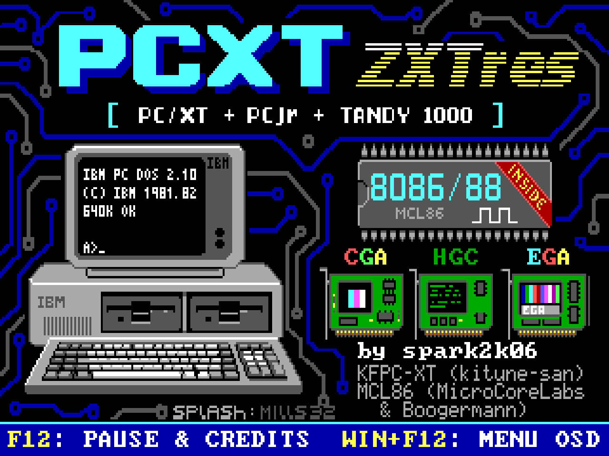

# PCXT for ZXTRES+ and ZXTRES++



PCXT for the ZXTRES+ and ZXTRES++ is the IBM PC/XT, Tandy 1000 and IBM PCjr
core of [PCXT_MiSTer](https://github.com/MiSTer-devel/PCXT_MiSTer) for the
boards' Xilinx Artix-7: the XC7A100T of the ZXTRES+ and the XC7A200T of the
ZXTRES++, which are otherwise the same board. There is one build for each
FPGA, and a file for one does not load on the other. The plain ZXTRES, with a
smaller FPGA, is not supported.

The machine is the one of the MiSTer core, built with the options of its
`mister_pcxt_full` profile: the MCL86 8088/8086 CPU, the KFPC-XT chipset, the
CGA (with the Tandy 1000 and PCjr modes), Hercules and EGA cards, chosen in the
OSD, floppy and XT-IDE storage, EMS and UMBs, a serial mouse, a gameport, and
the Sound Blaster, OPL2, C/MS and Tandy audio devices. Only the logic around
the machine is specific to this board: the DeMiSTify controller and OSD, the
SD card, the video output and the audio output. A fix in the machine reaches
the MiSTer and the ZXTRES builds alike.

The port follows the [PCAT-286 ZXTres port](https://github.com/aitorgomez-net/PCAT-286_ZXTres)
and shares its board logic: the character-grid OSD and its firmware, the
storage masters of the management window, the line doubler, the SRAM scan
converter for the 350-line modes, the video information page and the build
scripts.

The core is loaded from the microSD card as a `.ZX3` file, with the NMI
browser of the ZX Spectrum core. It does not replace the installed cores.

The machine description and the CPU, memory and video documentation are in
the [main README](../README.md), which applies here as well, except where the
table [below](#what-the-board-does-not-have) says otherwise.

## State of the port

**The port has just started.** Nothing has run on a board yet. See
[SPEC.md](SPEC.md) for what is built, what is simulated and what remains.

## What the board does not have

| MiSTer feature | On the ZXTRES+ |
| --- | --- |
| MiSTer scaler, HDMI, aspect ratio, HQ2x, scanlines | VGA output at 480p, or at 15.7 kHz; the 350-line EGA and Hercules pictures go through a scan converter in the board's SRAM instead of the MiSTer DDR3 framebuffer. DisplayPort is not implemented. |
| COM2, MIDI, MPU-401 and MT32-pi on the user port | The board has no user port. |
| Second SD card as an IDE disk | The one microSD slot belongs to the controller. |
| Real-time clock from the HPS | The board has none. |
| Analog joysticks | The DB9 ports give directions and buttons only; the OSD offers Digital first. |
| PCjr RAM size, tape sound | Not in the OSD: the 62 status bits of the controller are all in use. The PCjr has 640 KiB. |
| Return to the Spectrum core from the OSD | Power cycle the board. |
| Image files created by the core | The controller can write a file but not create one: `PCXT.CFG` must exist, see below. |

## Preparing the microSD card

The core looks for its files in a folder `PCXT` at the root of the card, or
in the root when there is no such folder.

| File | What it is |
| --- | --- |
| `PCXT.ROM` | The PC/XT BIOS (the first 64 KiB of the file are used). The [BIOS Builder](../SW/ROMs) of the MiSTer core prepares it and the others. |
| `TANDY.ROM` | The Tandy 1000 BIOS, for the Tandy 1000 machine. |
| `PCJR.ROM` | The PCjr BIOS, for the PCjr machine. |
| `EGA.ROM` | The EGA BIOS, for the EGA card. |
| `EC00.ROM` | The EC00 option ROM: the XT-IDE BIOS, needed for the hard disks. |
| `PCXT.CFG` | 512 bytes of zeroes, made once. Written by *Save settings* in the OSD; zeroes mean default settings. |
| Disk and floppy images | Anywhere on the card, chosen in the OSD. Hard disks are `.VHD` or `.IMG`, floppies `.IMG`, `.IMA` or `.VFD`. |

A missing ROM leaves its slot empty: the machine asks only for the BIOS of
the machine and the card chosen in the OSD, and holds the splash until it is
there. Any other file of the card can be chosen for each slot in the OSD page
*BIOS*, which also takes the two PCjr cartridges (`.JRC` files). A cartridge
stays in for the session only, and the machine restarts to see it.

`PCXT.CFG` keeps the OSD settings, the path of each of the four images and of
the five BIOS files, so the next start mounts them again. Without it, nothing
is mounted and the defaults apply. After choosing a hard disk, use *Reset* in
the OSD so the BIOS detects it.

## Loading the core

1. Copy `PCXT.ZX3` to the card, with the files above.
2. In the ZX Spectrum core, press F5 for the NMI browser, select the file and
   load it. The core goes to a temporary flash slot.
3. To go back to the Spectrum core, power cycle the board.

Connect a VGA monitor, or a 15 kHz TV through a suitable adapter. Plug the
PS/2 mouse in before the core starts, or before a reset from the OSD, because
the converter handshakes with it at that point.

Ready-made `.ZX3` files will be in [releases](../releases), in `A100T-board`
for the ZXTRES+ and `A200T-board` for the ZXTRES++.

## Keys and the OSD

| Key | Action |
| --- | --- |
| Win+F12 | Open the OSD |
| Cursor keys, Enter | Move in the menu, change an option or open a page |
| Esc | Back out of a page; from the main page, close the OSD |
| F12 | Pause the machine and scroll the credits; F12 again resumes |

The keyboard does not reach the machine while the OSD is open. F12 alone
stays with the machine and, on the splash, holds it.

The main page lists the four drives with the name of the image in each, a
Machine group (machine, CPU speed, write protect), and the pages *Video*
(card, monitor, Hercules options, display tint, composite, border, frame
stacking, and the *Output* page: CRT offsets, scandoubler, 350-line CRT
output, splash time, video info), *Audio* (sound cards, levels), *Hardware*
(CPU type, fake 286 flags, writable BIOS, EMS, UMBs, joysticks), *BIOS* (the
five BIOS files and the two PCjr cartridges) and *Settings* (info, OSD position, save settings, reset to
defaults), then Reset.

## Video outputs

| Source | Output |
| --- | --- |
| 200-line CGA, Tandy, PCjr and EGA modes | Doubled to 31.4 kHz, 640x480 at about 60 Hz |
| 350-line EGA and Hercules/MDA | `350-line CRT`: *480p 31 kHz* (720x480 at 59.94 Hz, the default), *Native*, *480i 15 kHz* or *240p 15 kHz* |
| 15 kHz output | *Scandoubler: Off* leaves the 200-line modes at 15.7 kHz with +HSync and +VSync |

## Building

The build needs Vivado 2025.2 (the part is `xc7a100tfgg484-2` for the ZXTRES+
and `xc7a200tfbg484-2` for the ZXTRES++), Python 3, and `nasm`, `gcc` and
`make` for the controller firmware (from WSL if the host is Windows). Run the
scripts from the repository root, from Git Bash on Windows or from Linux:

```sh
zxtres/scripts/build_firmware.sh    # EightThirtyTwo toolchain and firmware
zxtres/scripts/build_pcxt.sh        # Vivado, ZXTRES+ (A100T), to a .ZX3 file
zxtres/scripts/build_pcxt.sh A200T  # the same for the ZXTRES++
```

The result is `build/zxtres-pcxt/vivado-pcxt/PCXT.ZX3` (`vivado-pcxt-a200t`
for the ZXTRES++), next to the `.bit` file and the timing and utilization
reports. The DeMiSTify and `mist-modules` submodules must be checked out
(`git submodule update --init --recursive`). `PCXT_PROFILE` chooses another
MiSTer profile of `profiles/` for the machine options.

`build_pcxt.sh A100T project` writes, with no Vivado run,
`zxtres/vivado/create_project_A100T.tcl` (and `_A200T`), which create the
Vivado project from inside Vivado on any host (`source` it from the Tcl
console).

`zxtres/rtl/pcxt_zxtres_guest.sv` is generated from `PCXT.sv` by
`zxtres/scripts/make_guest.py`, which copies the machine blocks as they are
and adds the board glue. `build_pcxt.sh` checks that the committed file is not
stale.

## Simulation

The unit tests of the shared board logic run under WSL or Linux, with
Verilator and Icarus Verilog, from `zxtres/sim`: the IDE and floppy stores
against the machine's own devices, the line doubler, the scan converter, the
video information, the OSD, the keyboard filter, the keyboard relay with
the machine's own keyboard converter, the ROM loading queue and the serial
mouse. The
whole-board simulation of the PCAT port (`run_bios_sim.sh`) is still to be
adapted to this machine.

## Credits and licenses

Thanks to [Antonio Villena](https://antoniovillena.com/) for the ZXTRES+
board, also thanked in the F12 credits.

The port builds on [DeMiSTify](https://github.com/robinsonb5/DeMiSTify) by
Alastair M. Robinson, on the MiST core modules (`mist-modules`), on the
earlier PCXT DeMiSTify port and on the PCAT-286 ZXTres port. The OSD font is
from jtframe by Jose Tejada ([@jotego](https://github.com/jotego), GPL v3).
The machine blocks and their authors are credited in the main README and in
[credits/msg](credits/msg), the text of the F12 credits. The inherited
[LICENSE](../LICENSE) is GNU GPL version 3; component licenses and headers
stay authoritative for their files.
